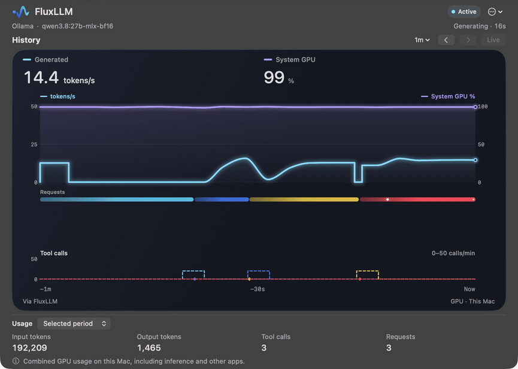
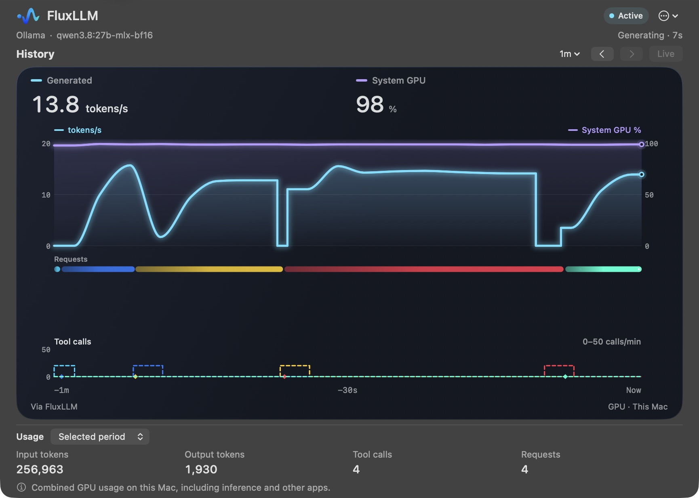
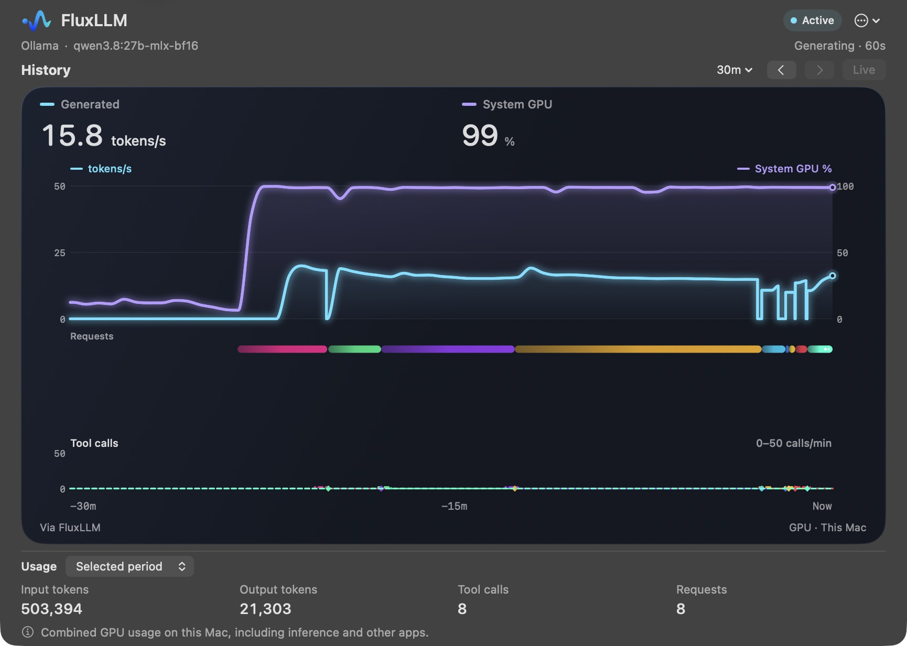
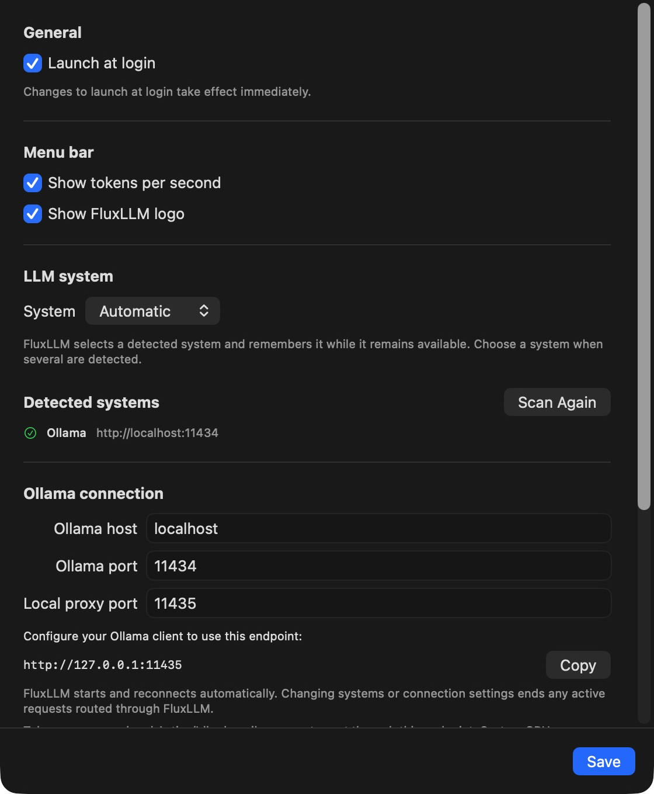

# FluxLLM

## Origin

I wanted to see what ollama was going on my MacBook and couldn't find a status bar app that I liked. Here is the product of lots of AI prompts to tweak the look and feel and operation to what I thought would be a neat looking tool. I hope you enjoy it as much as I do.

If there is something you'd like tweaked or fixed feel free to open issues or PRs.

## Preview

Captured from the running FluxLLM app (version 0.1.0) during real local Ollama inference.

Live request activity and token throughput:



Track throughput, this Mac’s total GPU utilization, request timelines, and usage totals:



<details>
<summary>More screenshots</summary>

Review 30 minutes of inference activity and request history:



Configure backend connections and menu-bar preferences:



</details>

## Install with Homebrew

Once a stable release and its cask have been published, install the current
release with:

```sh
brew tap chmorgan/fluxllm https://github.com/chmorgan/fluxllm.git
brew install --cask chmorgan/fluxllm/fluxllm
```

The existing repository serves as the public tap; no separate `homebrew-`
repository or download credentials are needed. Use `brew upgrade --cask
chmorgan/fluxllm/fluxllm` to update to the current stable release.

To select an exact published version, including a prerelease, use its versioned
cask. Only one FluxLLM cask can be installed at a time, so uninstall the current
cask before switching:

```sh
brew uninstall --cask chmorgan/fluxllm/fluxllm
brew install --cask chmorgan/fluxllm/fluxllm@0.1.1
```

Replace `0.1.1` with the published version you want. If switching from another
exact version, use that cask's name in the uninstall command. Versioned casks
stay on their selected release; their GitHub release assets must remain
available.

## Features

A macOS 15+ menu bar app for monitoring LLM inference with Ollama, vLLM,
Rapid-MLX, llama.cpp, and local Unsloth Desktop/Studio. Shows token throughput, activity history, and this
Mac’s total GPU utilization.

Choose a backend in Settings. For Ollama, point clients using `/api/chat` or
`/api/generate` at `http://127.0.0.1:11435`; the default upstream is
`localhost:11434`. Other backends are monitored directly through their metrics
or status endpoints. Backend and menu-bar preference changes apply for the
current launch and are not saved. Previously saved preferences are read at startup.

For **Unsloth**, choose **Unsloth** and enter its local Studio address, normally
`http://127.0.0.1:8888`. FluxLLM discovers the managed GGUF inference worker and
follows its changing port when models reload. Clients keep using Unsloth directly.
Monitoring is read-only and does not load models. Throughput is the worker's
reported average; token counts are its server totals. Individual request history,
tool-call accounting, remote Unsloth, and training telemetry are not included.

Enable **Settings → General → Launch at login** to start FluxLLM automatically
when you sign in. The change takes effect immediately, separately from other
settings.
If macOS requires approval, use **Open Login Items Settings** to allow FluxLLM.
You can turn the option off again without quitting the app.

The dashboard's **Usage** row shows Ollama input/output tokens, tool calls, and
requests. Choose **Since launch**, **Selected period**, or **Today**; totals are
kept separately from the chart. `~` marks estimated output and `+` marks a known
input subtotal when some requests have not reported input usage.

Use the **History** menu for ranges through **24h**, or enter custom dates.
Drag across the chart to zoom, use the arrow buttons to move through history,
and select **Live** to follow new activity again. Double-click a request rail
or use its **Fit request** context menu to frame that request.

History stays in memory for the current launch and resets when FluxLLM exits.
A long-running session retains up to 24 hours of chart history and 30 days of
bounded request usage. Recent charts retain detailed samples; older history
uses minute averages. Usage contains counts, timing, model names, and tool
names, with no prompt text, response text, tool arguments, or result contents.
History is separated by backend endpoint. Existing history files from earlier
versions are ignored and left untouched. Other backends continue to show their
server-reported token totals.

Optional diagnostic logging is off by default. When enabled, it writes bounded,
rotating logs containing event metadata, identifiers, timing, and counts.
Diagnostic logs do not save or restore dashboard history. Logging starts disabled
again on the next launch.

See [DESIGN.md](DESIGN.md) for architecture, measurement semantics, and limitations.

## Development checks

Install the repository's pre-commit hook after cloning:

```sh
scripts/install-git-hooks.sh
```

The installer preserves other Git hooks. It refuses to replace an existing
unowned `pre-commit` hook or a custom `core.hooksPath`; resolve that conflict
before installing. The installed dispatcher runs the tracked
[pre-commit hook](.githooks/pre-commit), which calls:

```sh
python3 scripts/check-swift-format.py --staged
```

The hook checks staged Swift contents with the staged `.swift-format`
configuration, including partially staged files. A configuration change checks
all indexed Swift files. It never reformats files or changes the index, and a
failed check rejects the commit. Use the checker's `--worktree` mode to check
current files while preparing changes; `build-dev.sh` uses the same checker
before building. Full builds and tests run separately.

## Continuous integration

The [CI workflow](.github/workflows/ci.yml) runs on pull requests and pushes with
two independent jobs. Both use Python 3.12:

- **macOS:** `macos-15` on Apple Silicon with Xcode 26.3 runs the Swift tests
  with coverage, compiles both Release app executables, and tests all release scripts.
- **Python:** `ubuntu-26.04` runs the mock server tests.

Run the same checks locally from the repository root. The Swift checks require
a supported Mac with Xcode installed:

```sh
swift test --enable-code-coverage
swift build -c release --product FluxLLMApp
swift build -c release --product FluxLLMPerformanceApp
(
  for test_script in Tests/Scripts/*-tests.sh; do
    bash "$test_script" || exit
  done
)
python3 -m unittest discover -s scripts -p 'test_mock*.py' -v
```

These checks need no downloaded models, external inference servers, or signing
secrets. Backend integration tests use local mock servers; release-script tests
use fixtures and mock builds, signing, notarization, and GitHub operations.

Hardware tests are skipped by default. On a supported Mac, set the
corresponding environment variable when running `swift test` to opt in:

| Environment variable | Hardware check |
| --- | --- |
| `FLUXLLM_GPU_PROBE=1` | Enumerate GPU accelerators and clients through IOKit. |
| `FLUXLLM_GPU_LIVE=1` | Read GPU activity from an already-running local Ollama worker. |
| `FLUXLLM_UNSLOTH_LIVE=1` | Read metrics from an already-running local Unsloth GGUF worker; never start inference. |
| `FLUXLLM_SYSTEM_GPU_LIVE=1` | Read total system GPU utilization. |

The live Ollama test does not start inference; start the required worker activity
before running it. Regular GPU tests use fixtures and run in CI.

Run the automated native Unsloth resource workload with:

```sh
python3 scripts/run_performance_checks.py baseline --backend unsloth
```

It builds the Release performance app and runs three fresh app lifetimes with
90 seconds of scheduled load: never-opened UI, visible UI, and logging off/on/off.
An external synthetic server applies idle, ordinary, and high-rate generation
load. The app uses the production native metrics adapter with synthetic process
discovery; real process discovery is covered separately by deterministic tests
and the opt-in live check. No requests are sent to your real model.

CPU, memory, writes, visibility, and GPU evidence use the existing resource gates.
The default coarse GPU provider is still a capability probe and cannot grant a
performance pass. Use `--gpu-provider instruments` for calibrated process GPU
execution measurements; those recordings can affect CPU measurements. Missing
administrator authorization for filesystem tracing also prevents a pass.
Results and comparison tables are kept in ignored `.performance-results/`
directories and are never overwritten. Use `check` instead of `baseline` to
enforce the budgets against later changes. Native metrics do not supply individual
request or tool histories, so this workload does not seed fabricated request data.

For a read-only HTTP compatibility check against an already loaded model:

```sh
python3 scripts/unsloth_live_check.py --studio http://127.0.0.1:8888 \
  --worker http://127.0.0.1:54234 --samples 10 \
  --output .performance-results/unsloth-live-new
```

Replace the worker port with the current native worker's port. This check reports
compatibility and counters; it does not measure app CPU or GPU consumption.

### Local desktop previews

Use [package-preview.sh](package-preview.sh) to package already-built Release
products for testing on your own Mac. Supply their native products directory,
the full commit SHA recorded in its `provenance.json`, and a new output directory:

```sh
./package-preview.sh --products /path/to/native-products \
  --commit FULL_40_CHARACTER_COMMIT_SHA --output .build/desktop-preview
```

The input must include clean Release provenance and its source inventory. The
packager verifies the executable and branding, creates a commit-labelled `.app`,
stamps `FluxLLMCommitSHA`, signs it ad hoc, and writes `preview-info.json` with
source and packaged hashes. It performs no build, installation, app launch or
shutdown, and never overwrites an existing output. This local preview is not
notarized and does not enable performance-test configuration. When ready to try
it, quit the existing FluxLLM normally and open the generated app by its exact
path; both use the same application identifier and settings.

## Releases

[package-release.sh](package-release.sh) builds a tagged version, signs and
notarizes it, verifies the final ZIP, and generates release notes and Homebrew
casks for Apple Silicon on macOS 15+. Run packaging on an Apple Silicon Mac
with Xcode tools, Python 3.9+, and a full clone with its tags. Publishing uses
the GitHub CLI (`gh`), authenticated for `chmorgan/fluxllm`.

### One-time setup

Install your Developer ID Application certificate and its private key in
Keychain. The script selects your sole valid Developer ID Application identity
and uses the `fluxllm` notarization profile. If several identities are available,
it lists them so you can select one with `--signing-identity`.

On first use, enter your Apple Developer account email and an app-specific
password when prompted. Credentials are saved in Keychain for future releases.

To create a password, sign in at [account.apple.com](https://account.apple.com)
and select **Sign-In and Security → App-Specific Passwords → Generate an
app-specific password**.

For publishing, configure your Git commit name and email and authenticate `gh`
with permission to publish releases and push cask updates to `main`. Branch
protection still applies; the script reports a rejected push without bypassing
the repository's rules.

### 1. Tag and package

Before preparing release changes on `main`, run `git pull --ff-only origin main`
to include prior automated cask commits. If your branch has diverged, integrate
the remote changes through your normal Git workflow first.

Review and commit all release changes, including tooling, dependency pins, and
`LICENSE`. From that commit on `main`, run these commands in the same terminal,
choosing an unused `MAJOR.MINOR.PATCH` version without a `v` prefix:

```sh
release_tag=0.1.1
git push origin main
git tag -a "$release_tag" -m "FluxLLM $release_tag"
git push origin "refs/tags/$release_tag"
./package-release.sh "$release_tag"
release_dir="$PWD/.build/releases/$release_tag"
```

The script must match its copy in the tag. It builds that commit in isolation
and derives the app version and archive name from the tag. Before reporting
`Release ready`, it verifies the archive checksum, contents, version, commit,
architecture, signature, stapled notarization, and Gatekeeper acceptance.
It also writes `Casks/fluxllm.rb` and `Casks/fluxllm@<tag>.rb` beneath the release
output directory, using the verified ZIP's checksum. These generated files are
local release artifacts; publishing updates the repository's tap automatically.
Existing output directories are never overwritten; retry with `--output-dir`
pointing to a new directory under `.build/` or outside the repository, and update
`release_dir` accordingly.

Commit tooling changes before creating a new tag so its script matches the one
you invoke. Never move a published release tag.

### 2. Install and try the packaged app

```sh
./install-release.sh "$release_tag"
```

The installer verifies the archive, gracefully quits any running FluxLLM, and
installs the verified app at `~/Applications/FluxLLM.app` without `sudo`. It
keeps a backup of the previous installation, launches the installed app, and
checks that it stays running briefly. If installation or startup fails, it
restores the previous installation when safe and reports any recovery steps.

If packaging used a custom output directory, add `--release-dir "$release_dir"`.
Use `--install-dir DIR` for another installation folder, or `--no-launch` to
install without launching or checking startup. You can try the app from its
menu bar icon; the automatic startup check does not exercise backend
monitoring, the proxy, or other UI features.

Release notes are generated automatically; editing
`$release_dir/release-notes.md` is optional. They start with commit subjects from
the previous release tag to the current tag, or the full history for the first
release. The previous tag is the highest lower `MAJOR.MINOR.PATCH` version
reachable from the current tag.

**`release-notes.md` is a local, untracked file under the ignored
`.build/releases/<tag>/` directory. Do not commit it.** Publishing reads this
file and preserves your edits. Keep `build.log` and `notarization.json` locally
too.

### 3. Stage and publish

Create or update a draft stable release:

```sh
./publish-release.sh "$release_tag" --stable
```

The script verifies the archive and remote tag, uploads the ZIP, checksum, and
release metadata, then downloads the assets to verify their contents. Review
the draft's notes and files, then publish:

```sh
./publish-release.sh "$release_tag" --stable --publish
```

After publication and download verification, the script commits and pushes
`Casks/fluxllm@<tag>.rb` to `main`. A newer stable release also updates
`Casks/fluxllm.rb`. The cask commit follows the release tag; older versioned
casks are preserved. This push leaves your local checkout unchanged. Drafts
leave the tap untouched.

For a prerelease, omit `--stable` from both commands. Prereleases get only their
version-specific cask. For custom packaging output, add
`--release-dir "$release_dir"` to both commands.

If publication or the cask push fails, rerun the same publishing command. For
an already published release, the script downloads and verifies its assets,
then finishes any missing tap update. A missing default release directory is
fine; if custom output is gone, omit `--release-dir` when retrying. Any existing
local release directory must contain complete artifacts.

A completed update creates no extra commit, and rerunning an older release
never downgrades `fluxllm.rb`. Conflicting existing casks cause an error.
Published assets, notes, and release status are preserved; use a new version
for subsequent changes, and keep historical assets available for older casks.

To rerun archive verification independently:

```sh
./verify-release.sh "$release_tag" --release-dir "$release_dir"
```

Packaging generates notes automatically. To generate a missing notes file
separately, run `./generate-release-notes.sh "$release_tag"`. Use
`--previous-tag <version>` to choose a different earlier ancestor tag, or
`--output <file>` for another ignored or external destination. Existing notes
are never overwritten.

<details>
<summary>Optional signing and profile overrides</summary>

Use `--signing-identity` with a full Developer ID Application name or its
40-character SHA-1 fingerprint, and `--notary-profile` for another Keychain
profile:

```sh
./package-release.sh "$release_tag" \
  --signing-identity 'Developer ID Application: Your Name (TEAMID)' \
  --notary-profile another-profile
```

For unattended packaging, create the selected profile interactively on that
machine first, for example with `xcrun notarytool store-credentials fluxllm`.
A missing profile without an interactive terminal stops before building and
prints the setup command.

</details>
